# Service Scheduler Data Model

This document describes the PostgreSQL schema implemented in `be/src/database/schema.ts` and the generated SQL migrations under `be/drizzle/`. `docs/plan.md` remains the product/API plan; this file is the detailed entity and persistence reference.

## Entity relationship diagram

```mermaid
erDiagram
    USERS ||--o| CUSTOMERS : "linked account"
    USERS ||--o{ DEALERSHIP_MEMBERSHIPS : has
    DEALERSHIPS ||--o{ DEALERSHIP_MEMBERSHIPS : grants
    DEALERSHIPS ||--o{ DEALERSHIP_CUSTOMERS : serves
    CUSTOMERS ||--o{ DEALERSHIP_CUSTOMERS : associated_with

    CUSTOMERS ||--o{ VEHICLES : owns
    DEALERSHIPS ||--o{ DEALERSHIP_VEHICLES : assigned
    VEHICLES ||--o{ DEALERSHIP_VEHICLES : available_at
    CUSTOMERS ||--o{ CUSTOMER_VEHICLE_ACCESS : receives
    VEHICLES ||--o{ CUSTOMER_VEHICLE_ACCESS : shared_with

    DEALERSHIPS ||--o{ DEALERSHIP_SERVICES : offers
    SERVICE_TYPES ||--o{ DEALERSHIP_SERVICES : offered_as
    DEALERSHIPS ||--o{ DEALERSHIP_HOURS : schedules
    DEALERSHIPS ||--o{ DEALERSHIP_CLOSURES : closes

    DEALERSHIPS ||--o{ TECHNICIANS : employs
    TECHNICIANS ||--o{ TECHNICIAN_QUALIFICATIONS : qualified_by
    SERVICE_TYPES ||--o{ TECHNICIAN_QUALIFICATIONS : qualification_for
    TECHNICIANS ||--o{ TECHNICIAN_SHIFTS : works
    TECHNICIANS ||--o{ TECHNICIAN_LEAVES : unavailable_for

    DEALERSHIPS ||--o{ SERVICE_BAYS : contains
    SERVICE_BAYS ||--o{ BAY_SERVICE_CAPABILITIES : supports
    SERVICE_TYPES ||--o{ BAY_SERVICE_CAPABILITIES : capability_for

    CUSTOMERS ||--o{ APPOINTMENTS : books
    VEHICLES ||--o{ APPOINTMENTS : serviced_vehicle
    DEALERSHIPS ||--o{ APPOINTMENTS : hosts
    SERVICE_TYPES ||--o{ APPOINTMENTS : requested_service
    TECHNICIANS ||--o{ APPOINTMENTS : assigned_to
    SERVICE_BAYS ||--o{ APPOINTMENTS : assigned_to
    USERS ||--o{ APPOINTMENTS : creates

    USERS ||--o{ IDEMPOTENCY_RECORDS : acts
    APPOINTMENTS ||--o{ IDEMPOTENCY_RECORDS : result_for

    USERS {
        uuid id PK
        varchar email UK
        text password_hash
        timestamptz email_verified_at "nullable; MVP does not require verification"
        integer token_version
        boolean is_active
        timestamptz created_at
        timestamptz updated_at
    }
    CUSTOMERS {
        uuid id PK
        uuid user_id FK "nullable unique"
        varchar email UK
        varchar first_name
        varchar last_name
        varchar phone "nullable"
        boolean is_active
        timestamptz created_at
        timestamptz updated_at
    }
    DEALERSHIPS {
        uuid id PK
        varchar name
        varchar address_line1
        varchar address_line2 "nullable"
        varchar city
        varchar region
        varchar postal_code
        varchar country_code "uppercase ISO alpha-2"
        varchar timezone "IANA timezone"
        boolean is_active
    }
    DEALERSHIP_MEMBERSHIPS {
        uuid id PK
        uuid dealership_id FK
        uuid user_id FK
        enum role "owner, manager, staff"
        boolean is_active
    }
    DEALERSHIP_CUSTOMERS {
        uuid dealership_id PK,FK
        uuid customer_id PK,FK
        uuid created_by_user_id FK "nullable"
        timestamptz created_at
        timestamptz updated_at
    }
    VEHICLES {
        uuid id PK
        uuid owner_customer_id FK
        varchar vin UK
        varchar make
        varchar model
        integer year
        boolean is_active
    }
    DEALERSHIP_VEHICLES {
        uuid dealership_id PK,FK
        uuid vehicle_id PK,FK
        uuid assigned_by_user_id FK "nullable"
        timestamptz created_at
        timestamptz updated_at
    }
    CUSTOMER_VEHICLE_ACCESS {
        uuid customer_id PK,FK
        uuid vehicle_id PK,FK
    }
    SERVICE_TYPES {
        uuid id PK
        varchar name
        text description "nullable"
        boolean is_active
    }
    DEALERSHIP_SERVICES {
        uuid id PK
        uuid dealership_id FK
        uuid service_type_id FK
        integer duration_minutes "positive"
        boolean is_active
    }
    DEALERSHIP_HOURS {
        uuid id PK
        uuid dealership_id FK
        integer day_of_week "0 Sunday through 6 Saturday"
        time open_time "nullable when closed"
        time close_time "nullable when closed"
        boolean is_closed
    }
    DEALERSHIP_CLOSURES {
        uuid id PK
        uuid dealership_id FK
        timestamptz starts_at
        timestamptz ends_at
        varchar reason "nullable"
    }
    TECHNICIANS {
        uuid id PK
        uuid dealership_id FK
        varchar display_name
        varchar employee_code "nullable; unique per dealership"
        boolean is_active
    }
    TECHNICIAN_QUALIFICATIONS {
        uuid technician_id PK,FK
        uuid service_type_id PK,FK
        timestamptz valid_from "nullable"
        timestamptz valid_to "nullable"
    }
    TECHNICIAN_SHIFTS {
        uuid id PK
        uuid technician_id FK
        integer day_of_week
        time start_local_time
        time end_local_time
        boolean is_active
    }
    TECHNICIAN_LEAVES {
        uuid id PK
        uuid technician_id FK
        timestamptz starts_at
        timestamptz ends_at
        varchar reason "nullable"
    }
    SERVICE_BAYS {
        uuid id PK
        uuid dealership_id FK
        varchar bay_code "unique per dealership"
        boolean is_active
    }
    BAY_SERVICE_CAPABILITIES {
        uuid bay_id PK,FK
        uuid service_type_id PK,FK
    }
    APPOINTMENTS {
        uuid id PK
        varchar appointment_ref UK
        uuid customer_id FK
        uuid vehicle_id FK
        uuid dealership_id FK
        uuid service_type_id FK
        uuid assigned_technician_id FK
        uuid assigned_bay_id FK
        uuid created_by_user_id FK
        enum booking_channel
        enum status
        timestamptz starts_at
        timestamptz ends_at
        varchar service_name_snapshot
        integer duration_minutes_snapshot
    }
    IDEMPOTENCY_RECORDS {
        uuid id PK
        uuid actor_user_id FK
        varchar operation
        varchar idempotency_key
        varchar request_hash "lowercase SHA-256 hex"
        uuid appointment_id FK
        timestamptz created_at
        timestamptz expires_at "at most 24 hours after creation"
    }
```

## Entity details

All mutable domain tables use UUID primary keys and timezone-aware `created_at` / `updated_at` timestamps with database defaults. `customer_vehicle_access` and the qualification/capability link tables use composite primary keys instead of separate IDs.

| Entity | Purpose and important rules |
| --- | --- |
| `users` | Login identity. Email is unique and lowercase; `password_hash` is required and stores a salted, parameterized scrypt hash. `email_verified_at` is nullable and remains null for new MVP accounts; verification does not gate sign-in or booking. `token_version` is nonnegative and supports invalidating previously issued tokens. |
| `customers` | Customer profile and contact information. `user_id` is nullable and unique so staff can create a customer before that customer has an account; customer registration links an active unlinked profile when its normalized email matches. A linked customer has at most one user. Customer email is unique and lowercase. |
| `dealerships` | Dealership identity, address, active state, and IANA timezone. Country code must be uppercase two-letter format. Timezone validity is an API validation responsibility. |
| `dealership_memberships` | Joins users to dealerships with one membership per user/dealership and role `owner`, `manager`, or `staff`. Memberships can be deactivated without deleting history. |
| `dealership_customers` | Associates customer profiles with dealerships authorized to manage them. The composite dealership/customer key permits one customer to work with multiple dealerships. `created_by_user_id` records the user who created the association. Staff customer and vehicle operations are scoped through this relationship. |
| `vehicles` | Vehicle owned by one customer. VIN is globally unique and 17 characters; model year is constrained to 1886 or later. Deactivate rather than delete vehicles referenced by appointments. |
| `dealership_vehicles` | Explicitly assigns a vehicle to a dealership. This is the authorization boundary for dealership staff vehicle listing, updates, and dealership-assisted sharing; associating a customer with a dealership does not expose any of that customer's vehicles. The composite dealership/vehicle key makes assignment idempotent, and `assigned_by_user_id` records the actor. |
| `customer_vehicle_access` | Explicit additional access to a vehicle. The vehicle owner already has access through `vehicles.owner_customer_id`; rows represent sharing with additional customers. |
| `service_types` | Shared service catalog entry with a globally unique name, optional description, and active state. Manager/owner catalog writes affect this shared reference catalog; dealership offerings remain scoped separately. |
| `dealership_services` | A dealership's offering for a service type. The dealership/service pair is unique and duration must be positive. The active offering's duration is authoritative; clients do not provide appointment end time. |
| `dealership_hours` | At most one weekly schedule record per dealership/day. Day numbering follows PostgreSQL convention: Sunday `0` through Saturday `6`. Closed days require null open/close times; open days require both times and `open_time < close_time`. The schema supports one continuous window per day. |
| `dealership_closures` | Dated dealership closure interval with optional reason. Timestamps are timezone-aware instants and `starts_at < ends_at`. |
| `technicians` | Technician belongs to one dealership and may have a dealership-unique employee code. Active state is separate from membership/schedule data. |
| `technician_qualifications` | Composite technician/service key, with optional validity bounds. The database prevents an appointment from assigning a technician without a matching qualification row; API logic must additionally check validity dates. |
| `technician_shifts` | Recurring local-time working window by technician and day of week. The complete appointment interval must fit an eligible shift. |
| `technician_leaves` | Dated unavailable interval with optional reason. Uses timezone-aware instants and a positive interval check. |
| `service_bays` | Bay belongs to a dealership and has a unique code within that dealership. |
| `bay_service_capabilities` | Composite bay/service key declaring which work that bay can support. The database requires a matching capability when a bay is assigned to an appointment. |
| `appointments` | Confirmed or historical service booking. Stores customer, vehicle, dealership, service, assigned technician and bay, authenticated creator, booking channel, status, start/end instants, and service name/duration snapshots. Reference is unique. Start must precede end, and the interval must equal the positive duration snapshot. |
| `idempotency_records` | Retry record for an authenticated operation, linked to its actor and resulting appointment. Its purpose and column rationale are described below. |

## Appointment integrity and capacity

Appointment foreign keys use `ON DELETE RESTRICT` to preserve history. Composite foreign keys additionally enforce that:

- The selected service is offered by the appointment's dealership.
- The assigned technician belongs to that dealership and has a qualification row for the service.
- The assigned bay belongs to that dealership and has a capability row for the service.

These relational checks do not determine whether entities are active or whether qualification dates, shifts, leave, dealership hours, or customer authorization permit a particular booking. Those checks remain server-side responsibilities and must be repeated during confirmation.

Dealership vehicle visibility is separate from customer/dealership association and customer/vehicle sharing. A dealership can see a vehicle only when a `dealership_vehicles` row assigns it there; for a particular dealership customer, the vehicle must also be owned by or explicitly shared with that customer. Existing customer/dealership links are not automatically backfilled into `dealership_vehicles`, because that could expose every vehicle belonging to those customers. Vehicles must be assigned through customer opt-in or staff-assisted intake.

Appointment instants, closures, leave, and qualification validity are `timestamptz` values stored as instants. Weekly opening hours and technician shifts are `time` values interpreted in the dealership's IANA timezone. Intervals use half-open `[start, end)` semantics: an appointment ending at 10:00 does not overlap one starting at 10:00.

PostgreSQL GiST exclusion constraints use `btree_gist` and `tstzrange(starts_at, ends_at, '[)')` to prevent overlap on each assigned technician and bay. The constraints apply only to `confirmed` appointments. `cancelled`, `completed`, and `no_show` records remain in history but do not reserve future capacity. Availability calculations and the database predicate must keep this same status rule.

## Idempotency records

### Why this table exists

Booking requests can be retried when a client times out, loses its connection, or does not receive the API response even though the server committed the appointment. Without idempotency, retrying a successful create request could create a second appointment and reserve additional capacity. The idempotency record lets the API recognize a retry and return the original appointment result instead of executing the create operation again.

The key is scoped to the authenticated actor and operation. This prevents two users from colliding on the same key and prevents a key used for one operation from affecting another. The key alone is not authorization: the API still authenticates and authorizes each request.

### What the row contains

| Column | Role |
| --- | --- |
| `id` | UUID primary key for the record. |
| `actor_user_id` | Authenticated user who initiated the operation; restrictive FK to `users`. Staff-assisted bookings are scoped to the acting staff user, not the customer being booked for. |
| `operation` | Stable operation identifier, such as `appointment:create`. Distinguishes key namespaces for different operations. Must not be blank. |
| `idempotency_key` | Client-provided opaque key, up to 255 characters. Combined with actor and operation for uniqueness. |
| `request_hash` | Lowercase 64-character SHA-256 hex digest of the normalized request. Stores a digest rather than duplicating request data or PII. |
| `appointment_id` | The appointment produced by the original operation; restrictive FK preserves the replay target. |
| `created_at` | Database time when the idempotency record was created. |
| `expires_at` | Database timestamp defaulting to 24 hours after creation. A check requires it to be after creation and no later than the 24-hour limit. |

The unique constraint is `(actor_user_id, operation, idempotency_key)`. An index on `expires_at` supports cleanup. Records should be inserted as part of the same transaction as appointment creation so a failed booking does not leave a successful-looking replay record without its result.

### Expected request behavior

1. Authenticate the caller and normalize the booking request. Compute a stable SHA-256 hash over the normalized fields that affect the operation; do not hash volatile transport metadata.
2. Look up or claim the actor/operation/key tuple within the booking transaction.
3. If a non-expired record exists and its request hash matches, return the linked appointment as the replay result without creating another appointment.
4. If the tuple exists with a different hash, return `409` because the caller reused a key for a different request.
5. For a new key, revalidate eligibility, allocate technician and bay, create the appointment, and persist the idempotency row atomically. Database uniqueness resolves simultaneous requests using the same key; resource exclusion constraints independently resolve competing bookings.

Expiry defines the maximum replay window; it does not itself remove a row. Because the uniqueness constraint includes no time predicate, an expired row still occupies its key until cleanup removes it. The API/maintenance process must delete expired rows before accepting reuse of the same actor/operation/key. The referenced appointment is retained, so expiry must not cascade-delete appointment history.

## Database extensions and enum values

- `pgcrypto`: provides `gen_random_uuid()` defaults.
- `btree_gist`: allows UUID equality operators in the GiST resource/time exclusion constraints.
- `dealership_membership_role`: `owner`, `manager`, `staff`.
- `appointment_status`: `confirmed`, `cancelled`, `completed`, `no_show`.
- `booking_channel`: `customer_self_service`, `staff_assisted`.

The database schema intentionally does not include email verification codes, external identity-provider sessions, or audit-log tables in this MVP schema. Authentication verification delivery and the separately reviewed audit design remain outside this data-model migration.
