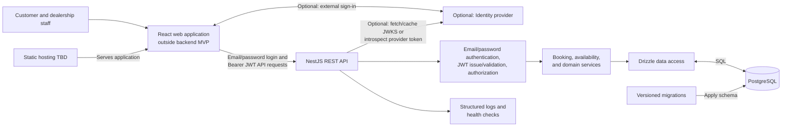

# Service Scheduler - System Design

## Purpose and scope

This document describes the target architecture. The backend MVP scope is defined in [mvp.md](mvp.md); customer and staff portals are part of the overall product but are not part of the backend MVP implementation.

## Architecture

## Responsibilities

- **Web application:** Provides customer and staff workflows. It displays availability but does not reserve slots or assign resources.
- **Optional: Identity provider:** An external sign-in integration that may be added later. It is separate from the API's native email/password login; email verification is also deferred beyond the MVP.
- **NestJS API:** Provides email/password authentication, issues and validates its signed JWT access tokens, and, if the optional identity provider is integrated, validates its tokens using configured issuer/audience and signing keys (JWKS) or token introspection. It then enforces customer and dealership scope and coordinates application services.
- **Application services:** Own booking eligibility, resource allocation, appointment lifecycle, and dealership configuration rules.
- **PostgreSQL and Drizzle:** PostgreSQL is the source of truth. Drizzle handles typed queries; SQL migrations manage PostgreSQL-specific constraints.

## Data flow

### Sign-in and authorization

1. A user signs up with email and password. The API stores a password hash and marks the new account unverified (`emailVerifiedAt` is null). Email verification is not implemented in the MVP.
2. The user signs in with email and password. The API returns a signed JWT access token; the browser sends it as `Authorization: Bearer <token>` to protected API endpoints.
3. The API validates the token signature, expiry, issuer, and audience, then resolves the active user and current customer or dealership membership before authorizing the action. Unverified status does not block MVP sign-in or customer booking. Staff actions are attributed to the authenticated staff member.
4. If optional external sign-in is added later, the browser sends the provider-issued token to the API as a bearer token. NestJS validates it against the provider's configured issuer and audience, using cached signing keys (JWKS) or token introspection, then maps the external identity to an application user. Provider tokens are not treated as NestJS-issued JWTs.

### Availability and booking

1. The browser requests availability for a dealership, vehicle, service, and date. The API checks access and evaluates dealership hours/closures, service duration, technician qualifications/shifts/leave, bay capabilities, and existing confirmed appointments for the full interval. MVP defaults are 2 hours minimum notice, a 60-day booking horizon, 15-minute start increments, fixed duration per dealership-service offering, and zero preparation/cleanup buffers.
2. The API returns candidate start times, not a reservation.
3. On confirmation, the API revalidates the request, derives duration, and allocates a technician and bay in a short transaction. PostgreSQL exclusion constraints apply to `confirmed` appointments only, preventing overlapping reservations; cancelled, completed, and no-show appointments do not reserve capacity. A race returns `409 SLOT_UNAVAILABLE`.
4. Booking idempotency records are scoped by authenticated actor and operation and store the request hash and resulting appointment for 24 hours. Matching retries return the original result; reusing a key for a different request returns `409`.
5. Cancellation preserves appointment history and releases capacity. Rescheduling updates the appointment only if the replacement interval can be secured atomically; otherwise the original remains unchanged.

### Staff configuration

Managers and owners update dealership configuration through the API. The API checks role and dealership scope before saving changes. Customer profiles are associated with dealerships through an explicit relationship; staff customer and vehicle operations are restricted to profiles associated with their dealership. Availability uses the saved configuration; changes must not rewrite appointment snapshots.

## Technology choices

| Area                     | Choice                                                                                         | Reason or status                                                                                                     |
| ------------------------ | ---------------------------------------------------------------------------------------------- | -------------------------------------------------------------------------------------------------------------------- |
| API                      | NestJS 11, TypeScript, REST/JSON                                                               | Modular services, request validation, guards, and API documentation.                                                 |
| Database and data access | PostgreSQL, Drizzle, `pg`, SQL migrations                                                      | Relational integrity and transactions, with custom SQL for overlap constraints.                                      |
| Local development        | Docker Compose with PostgreSQL                                                                 | Repeatable local development and integration tests.                                                                  |
| Web client               | React 19 and Vite; TanStack Router/Query; Tailwind and shadcn/ui                               | Target stack for the customer/staff portals, which are outside the backend MVP.                                      |
| Authentication           | NestJS email/password sign-up/sign-in with signed JWT access tokens; optional external identity provider | New accounts are unverified, but verification does not gate MVP sign-in or booking. Verification and external sign-in are deferred. |
| Production hosting       | Not selected                                                                                   | Choose API and database hosting and regions before deployment.                                                       |
| Observability            | Structured logs and health checks for MVP                                                      | Advanced metrics and distributed tracing are production follow-up work.                                              |

### Database and ORM selection

Appointments link customers, vehicles, dealerships, services, technicians, and bays. PostgreSQL transactions and GiST exclusion constraints over resource IDs and `tstzrange` intervals provide a database-level guard against overlapping bookings. Drizzle supplies typed queries; explicit SQL migrations manage PostgreSQL extensions and constraints that need custom DDL.

## Observability strategy

- **MVP application baseline:** Provide liveness/readiness checks and allowlisted HTTP request logs containing method, status code, and duration. Add booking outcome events when booking endpoints are implemented. Exclude credentials, request bodies, customer contact details, VINs, and other personal data.
- **Production application instrumentation:** Add metrics and distributed traces after booking and availability flows exist and a telemetry backend is selected. Telemetry export must not block requests or expose customer/vehicle data.
- **Deployment/operations:** Configure telemetry storage, retention/access, dashboards, alert thresholds, and notification routing with the production hosting environment and operational owner. These are not created automatically by backend logging or metric instrumentation.

## Security and data integrity

- Enforce customer ownership and dealership-scoped roles in the API; client-side route guards do not provide authorization.
- Hash passwords with a suitable password-hashing algorithm. Keep the JWT signing secret in environment-specific secret storage; validate signature, expiry, issuer, and audience on every protected request. Do not log credentials or tokens.
- Treat request IDs and selected slots as untrusted. Derive service duration and resource assignment on the server.
- Store appointment instants in UTC and interpret recurring schedules in the dealership's IANA timezone. Use `[start, end)` intervals.
- Preserve appointment history and snapshot booked service details so later configuration changes do not alter past bookings.
- Use TLS and managed secret storage in deployed environments; local Compose credentials are for development only.

## Decisions still open

- Decide later whether to integrate the optional external identity provider and email verification. Define staff provisioning for the MVP.
- MVP scheduling defaults are 60 days ahead, 2 hours minimum notice, 15-minute increments, fixed dealership-service durations, and zero buffers. Define actor permissions for appointment status transitions.
- Choose production hosting, regions, and API routing when deployment is in scope.
